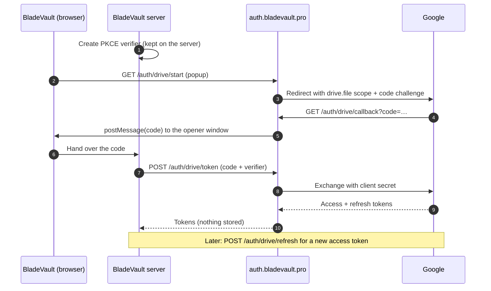

<div align="center">

<a href="https://bladevault.pro">
  
</a>

# BladeVault Auth

**The Google Drive sign-in service for [BladeVault](https://bladevault.pro): a stateless Cloudflare Worker that keeps the Google client secret off every self-hosted server.**

[](https://bladevault.pro)
[](https://github.com/dedkola/bladevault)

[](https://github.com/dedkola/bladevault-auth/actions/workflows/ci.yml)
[](https://auth.bladevault.pro/api/health)
[](LICENSE)
[](https://github.com/dedkola/bladevault-auth/commits/main)

[](https://workers.cloudflare.com)
[](https://www.typescriptlang.org)
[](https://hono.dev)
[](https://zod.dev)
[](https://sentry.io)
[](https://developers.google.com/drive/api/guides/api-specific-auth)

[Website](https://bladevault.pro) · [BladeVault app](https://github.com/dedkola/bladevault) · [How it works](#how-it-works) · [Routes](#routes) · [Configuration](#configuration) · [Development](#development) · [Deploying](#deploying)

</div>

---

## Why this exists

[BladeVault](https://bladevault.pro) is a local-first knife collection manager. It uploads and downloads backups straight to the user's own Google Drive. Only two steps need the Google client secret: exchanging the sign-in code and refreshing access. Those two steps run here, at `https://auth.bladevault.pro`.

- 🔒 **Stores nothing.** Tokens go straight back to the BladeVault server that asked. No database, no KV, no cookies.
- 📦 **No backup data passes through it.** Files move directly between BladeVault and Google Drive.
- 🧩 **Narrow scope.** Only `drive.file`, so BladeVault sees only the files it created.
- 🛡️ **PKCE-protected.** A sign-in code that reaches anyone else cannot be exchanged.
- 🏠 **Works with self-hosted servers.** Any BladeVault instance, on any address, can sign in.

## How it works



BladeVault creates the PKCE verifier and keeps it on its own server, so a sign-in code that reaches anyone else is useless. That is why `ALLOWED_CLIENT_ORIGINS` can stay `*`: self-hosted BladeVault servers run on any address.

BladeVault reads this service's address from `NEXT_PUBLIC_BLADEVAULT_AUTH_URL` and uses `https://auth.bladevault.pro` when it is unset.

## Routes

| Route                       | Called by           | Purpose                                                                  |
| --------------------------- | ------------------- | ------------------------------------------------------------------------ |
| `GET /auth/drive/start`     | Sign-in popup       | Checks the request and redirects to Google with the `drive.file` scope.  |
| `GET /auth/drive/callback`  | Google              | Sends the sign-in code back to the BladeVault window with `postMessage`. |
| `POST /auth/drive/token`    | BladeVault server   | Swaps the code and PKCE verifier for access and refresh tokens.          |
| `POST /auth/drive/refresh`  | BladeVault server   | Gets a new access token from a refresh token.                            |
| `GET /api/health`           | Monitoring          | Health check.                                                            |

## Configuration

| Name                     | Kind     | Notes                                                                                                                  |
| ------------------------ | -------- | ---------------------------------------------------------------------------------------------------------------------- |
| `GOOGLE_CLIENT_ID`       | Secret   | Google OAuth web client.                                                                                               |
| `GOOGLE_CLIENT_SECRET`   | Secret   | Google OAuth web client.                                                                                               |
| `AUTH_PUBLIC_BASE_URL`   | Variable | This Worker's public address; the Google redirect URI is `<this>/auth/drive/callback`.                                 |
| `ALLOWED_CLIENT_ORIGINS` | Variable | `*`, or a comma-separated list of origins (wildcards allowed). Local and private-network addresses are always allowed. |
| `SENTRY_DSN`             | Secret   | Optional. Error reporting is off without it; reports keep no tokens, codes or emails.                                  |
| `SENTRY_ENVIRONMENT`     | Variable | Optional, defaults to `production`.                                                                                    |

> [!IMPORTANT]
> In the Google Cloud console, the OAuth client must list `https://auth.bladevault.pro/auth/drive/callback` as an authorised redirect URI.

## Development

Requires Node.js (version in [`.nvmrc`](.nvmrc)).

```bash
npm ci
cp .dev.vars.example .dev.vars   # then fill in the values
npm run dev                      # http://localhost:8787
```

Point a local BladeVault at it with `NEXT_PUBLIC_BLADEVAULT_AUTH_URL=http://localhost:8787`.

| Script              | What it does                          |
| ------------------- | ------------------------------------- |
| `npm run dev`       | Runs the Worker locally with Wrangler |
| `npm run typecheck` | Type-checks with `tsc --noEmit`       |
| `npm run check`     | Bundles the Worker without deploying  |
| `npm run deploy`    | Deploys to Cloudflare                 |
| `npm run cf-typegen`| Regenerates Worker binding types      |

### Project layout

```
src/
├── index.ts    # Hono app, CORS, health check, error handling
├── drive.ts    # Google Drive sign-in routes
├── env.ts      # Environment parsing and origin checks
└── sentry.ts   # Sentry setup with token/code scrubbing
```

## Deploying

```bash
npx wrangler secret put GOOGLE_CLIENT_ID
npx wrangler secret put GOOGLE_CLIENT_SECRET
npm run deploy
```

> [!NOTE]
> The Worker keeps its original name, `bladevault-backend`, so deploying replaces the live code on `auth.bladevault.pro` and keeps its existing secrets and custom domain.

## Security

Found a vulnerability? Please report it privately. See [SECURITY.md](SECURITY.md).

## Contributing

Issues and pull requests are welcome. See [CONTRIBUTING.md](CONTRIBUTING.md).

## License

[MIT](LICENSE) © Nikolay Sokolovskiy

<div align="center">
<sub>Part of <a href="https://bladevault.pro"><b>BladeVault</b></a> · <a href="https://github.com/dedkola/bladevault">github.com/dedkola/bladevault</a></sub>
</div>
